# Equalship

**Save together. Own together.**

Equalship is a savings circle that lives on Robinhood Chain. A group of friends agrees on an amount and a schedule. Every period each member presses save once, and their USDG is swapped on Uniswap into a basket of Stock Tokens that lands straight in their own wallet. $WIF holds the group together: you bond it to join, you lose part of it when you skip, you burn it to vote, and 1% of every save buys it back and burns it.

**[Live app: equalship.vercel.app](https://equalship.vercel.app)** · **[Try it in 3 minutes](#try-it-in-3-minutes)** · [Contract on Blockscout](https://robinhoodchain.blockscout.com/address/0x3B5598d1bEBfeDF9a8E19526F728e3184a5F6A92) · [Verified source](https://repo.sourcify.dev/4663/0x3B5598d1bEBfeDF9a8E19526F728e3184a5F6A92) · [Submission](SUBMISSION.md) · [Security review](SECURITY.md) · [How the video was made](video/README.md)

[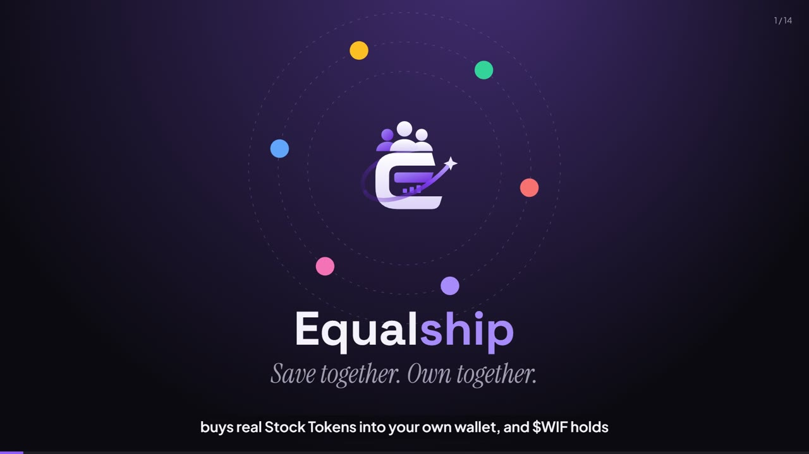](https://equalship.vercel.app)

*The demo film (2:54, narrated, captioned) is generated from this repository by the pipeline in [video/](video/README.md).*

Built for the **World is Flat** hackathon on Robinhood Chain.

## At a glance

| | |
| :- | :- |
| Network | Robinhood Chain mainnet, chain id 4663 |
| Contract | [`0x3B5598d1bEBfeDF9a8E19526F728e3184a5F6A92`](https://robinhoodchain.blockscout.com/address/0x3B5598d1bEBfeDF9a8E19526F728e3184a5F6A92), source verified (exact match) |
| What it buys | NVDA, AAPL, TSLA, MSFT, SPY, QQQ Stock Tokens and WETH, through Uniswap v3 |
| $WIF used for | Bond, slash burn, vote burn, buyback and burn |
| Custody | None. Assets go to the member's wallet in the same transaction |
| App | 17 page types, live prices and charts, multi wallet, dark and light, mobile |
| Tests | 17 unit and fuzz tests, plus a mainnet fork test with real Stock Token swaps |

## Contents

* [The idea in one minute](#the-idea-in-one-minute)
* [Live on Robinhood Chain mainnet](#live-on-robinhood-chain-mainnet)
* [Why Equalship](#why-equalship)
* [Try it in 3 minutes](#try-it-in-3-minutes)
* [Product tour](#product-tour)
* [How it works](#how-it-works)
* [The $WIF flywheel](#the-wif-flywheel)
* [Proof of Commitment](#proof-of-commitment)
* [Architecture](#architecture)
* [Design and user experience](#design-and-user-experience)
* [Verification and security](#verification-and-security)
* [Build log](#build-log)
* [Quickstart for developers](#quickstart-for-developers)
* [Repository layout](#repository-layout)
* [Documentation](#documentation)
* [Risks](#risks)
* [License](#license)

## The idea in one minute

* Most people never start investing. The first step is lonely and easy to put off.
* Savings circles fixed that for generations, under many names: tontine, susu, ajo, chit fund, tanda. You save because your group expects you to.
* Robinhood Chain now has Stock Tokens that anyone in an eligible region can hold in a wallet.
* Equalship puts the two together, and gives $WIF a job that repeats every week for as long as people keep saving.

| Savings circle habit | In Equalship |
| :- | :- |
| Everyone puts in the same amount | `contribute` takes the circle amount in USDG once per period |
| The pot buys something together | Each save buys the circle's basket of Stock Tokens into the saver's own wallet |
| Skipping lets the group down | Missing a period slashes the $WIF bond: half burned, half to the members who paid |
| The group decides together | Members change the basket by burning $WIF as votes |
| Everyone knows who is reliable | Every save builds a public Proof of Commitment record |

## Live on Robinhood Chain mainnet

**Contracts**

| Contract | Address |
| :- | :- |
| Equalship | [`0x3B5598d1bEBfeDF9a8E19526F728e3184a5F6A92`](https://robinhoodchain.blockscout.com/address/0x3B5598d1bEBfeDF9a8E19526F728e3184a5F6A92) |
| USDG | `0x5fc5360D0400a0Fd4f2af552ADD042D716F1d168` |
| $WIF | `0x5173b8eA6923c2d40267890D45C46a3480954773` |
| Uniswap SwapRouter02 | `0xCaf681a66D020601342297493863E78C959E5cb2` |
| Uniswap QuoterV2 | `0x33e885eD0Ec9bF04EcfB19341582aADCb4c8A9E7` |
| Multicall3 | `0xcA11bde05977b3631167028862bE2a173976CA11` |

**Key transactions**

| Event | Transaction |
| :- | :- |
| Deploy Equalship | [`0xd07ee961...`](https://robinhoodchain.blockscout.com/tx/0xd07ee96119a275617de1081b1e0814c4a5e8f4091f9113cd0a76a6e886db4177) |
| Approve $WIF for the bond | [`0x856935fb...`](https://robinhoodchain.blockscout.com/tx/0x856935fb0ae8b11f6159f02f2610662ceae1fbb5b64b9c4e092b97b6b5f7e7b3) |
| Approve USDG | [`0x2152eb8b...`](https://robinhoodchain.blockscout.com/tx/0x2152eb8be9b2c3b65927c6cf64d5ce56c8053eb5cf0b96262dcd5c237930a2d4) |
| Create circle #0 and lock 1,000 $WIF | [`0x027a66c8...`](https://robinhoodchain.blockscout.com/tx/0x027a66c86c2ea7db6dc4be3ce848ff0e6afffec7ed80043271e4e6f83b6cf129) |
| First save: 1 USDG buys NVDA and SPY into the member's wallet | [`0xe95d12f9...`](https://robinhoodchain.blockscout.com/tx/0xe95d12f9a850b27e80700a42045af21b669f14fa5b77e4f7fe137021e967ea2a) |

## Why Equalship

| | |
| :- | :- |
| **A real reason to use $WIF** | $WIF is the cost of quitting and the reward for staying, not a stake in a bet. Every part of a circle locks it or burns it. |
| **A flywheel that holds up** | Saving is a weekly habit, so the burn is weekly too. Demand grows with the number of savers, not with someone losing. |
| **Puts Stock Tokens to work** | Small, regular buys of NVDA, AAPL or the S&P 500, the way most people should build a position. |
| **Brings new people in** | Start from 1 USDG. A friend can pay your bond so you can begin with only USDG. |
| **Never holds your money** | Swaps send output to the member in the same transaction. Nothing to withdraw, nothing to lose. |
| **Useful beyond itself** | Proof of Commitment gives every app on Robinhood Chain a cheap filter for real people. |
| **Built in the open** | Source verified onchain, tested on real mainnet state, every line on GitHub. |

## Try it in 3 minutes

You need a browser wallet on Robinhood Chain (chain id 4663) with a little ETH for gas. To save, you also need 1 USDG and the circle's $WIF bond.

1. **Look around, no wallet needed (1 minute).** Open [equalship.vercel.app](https://equalship.vercel.app). The numbers under the ticker are read live from the contract. Open [Markets](https://equalship.vercel.app/markets) and click any asset for its live chart.
2. **See a live circle.** Open [Circle #0](https://equalship.vercel.app/circle/0). You will see its members, streaks, what it buys, when the period closes, and a slash button for any member who missed a period.
3. **Check a wallet's record.** Open [Proof of Commitment](https://equalship.vercel.app/proof) and paste any address.
4. **Join and save (2 minutes).** Click Connect wallet. Every installed wallet is listed. On a circle page press Bond and join, then Save. Your wallet shows an approval for the exact amount, then the save. The Stock Tokens arrive in your wallet in the same transaction.
5. **Or start your own.** On [Circles](https://equalship.vercel.app/circles), pick a name, an amount, every hour for a quick test, a bond and a basket, and press Create.

Prefer the terminal? Read the live state from any machine:

```bash
RPC=https://rpc.mainnet.chain.robinhood.com
SHIP=0x3B5598d1bEBfeDF9a8E19526F728e3184a5F6A92
cast call $SHIP "circleCount()(uint256)" --rpc-url $RPC
cast call $SHIP "totalSaved()(uint256)" --rpc-url $RPC          # USDG, 6 decimals
cast call $SHIP "totalBonded()(uint256)" --rpc-url $RPC         # $WIF, 18 decimals
cast call $SHIP "profileOf(address)((uint32,uint32,uint32,uint32,uint64,uint64,uint128))" 0xe1a19fbc9608be13b92da24dd4919589900db567 --rpc-url $RPC
```

## Product tour

The app has a landing page, the circle pages, live markets, the $WIF page, Proof of Commitment, and Learn and legal pages. Every page works in dark and light themes and on phones.

**Landing page.** A live price ticker, numbers read from the contract, three steps, a product carousel, live market cards, the security grid and an FAQ preview.

[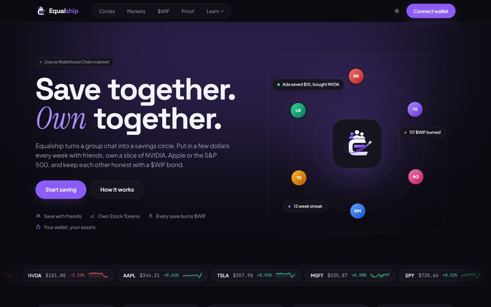](media/home.jpg)

**Markets.** Every asset a circle can buy, with live price, 24 hour change and range, pool volume and a trend line.

[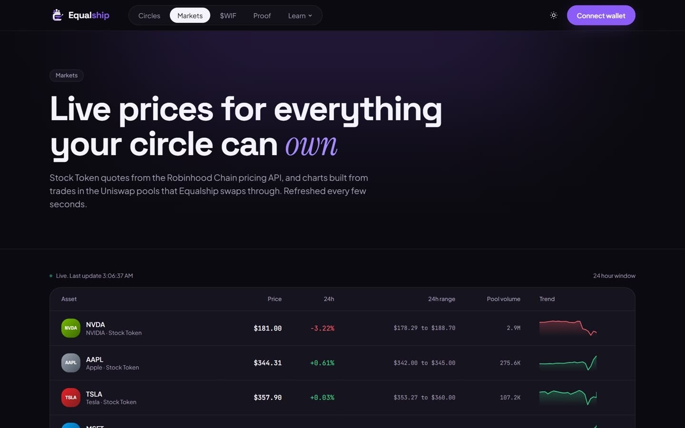](media/markets.jpg)

**Asset page.** An interactive chart with a hover crosshair, bid and ask, the token contract, and a button to save into it.

[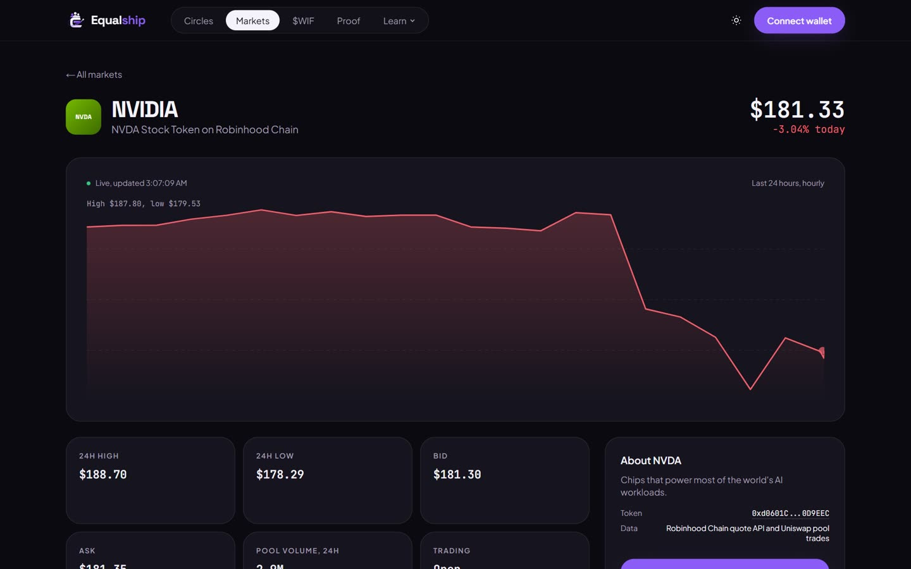](media/asset.jpg)

**Circles.** Every circle onchain, how full it is, and the form to start one with a basket picker.

[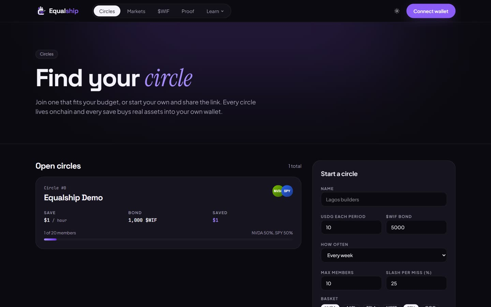](media/circles.jpg)

**Circle page.** Members, streaks and bonds, the period countdown, save, claim, leave, slash, invite and sponsor a friend, and the basket vote.

[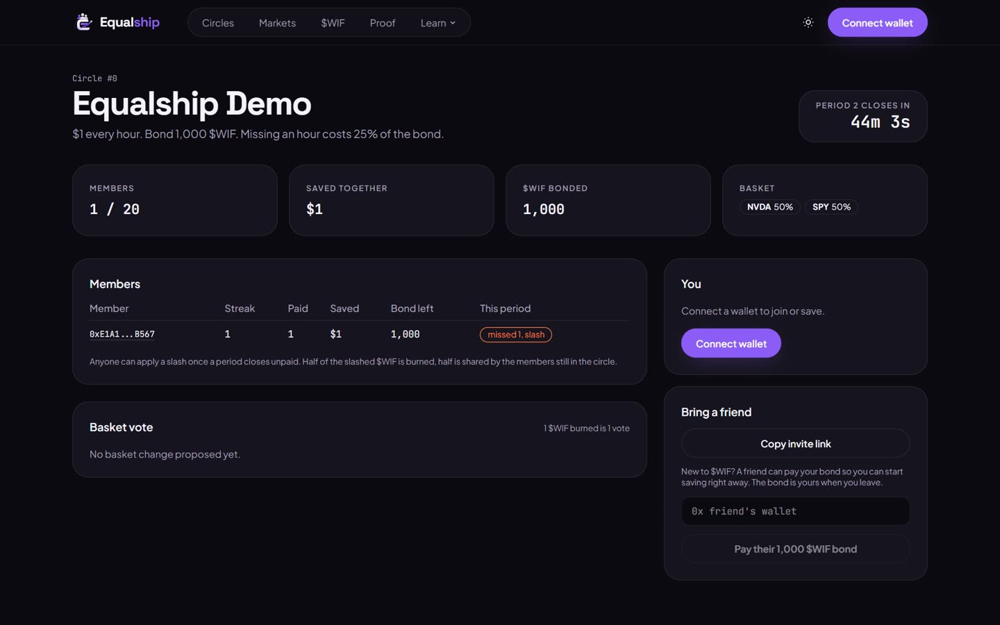](media/circle.jpg)

**$WIF.** The live $WIF price, what Equalship has burned and from where, how much is bonded, and the loop.

[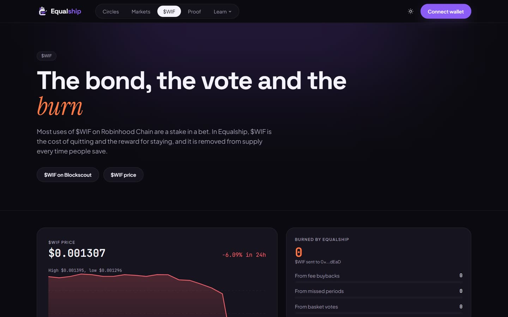](media/wif.jpg)

**Proof of Commitment.** Any wallet's savings record and the default committed saver check.

[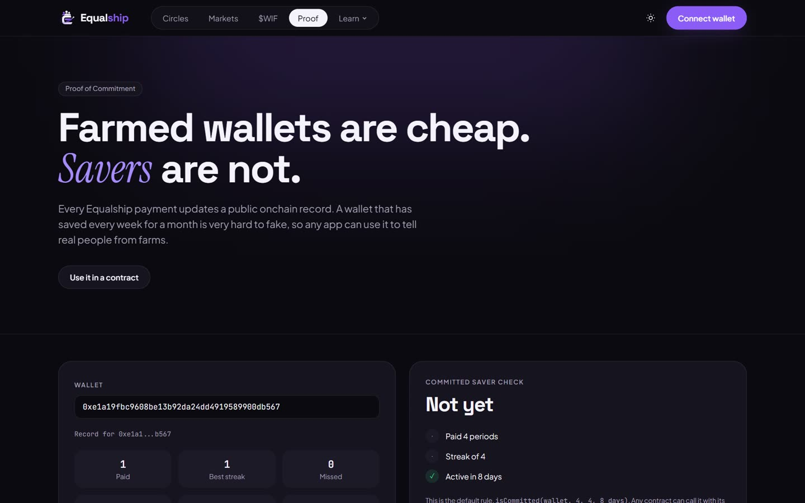](media/proof.jpg)

**Security and FAQ.** What the contract can and cannot do, what your wallet will ask you to sign, and straight answers.

[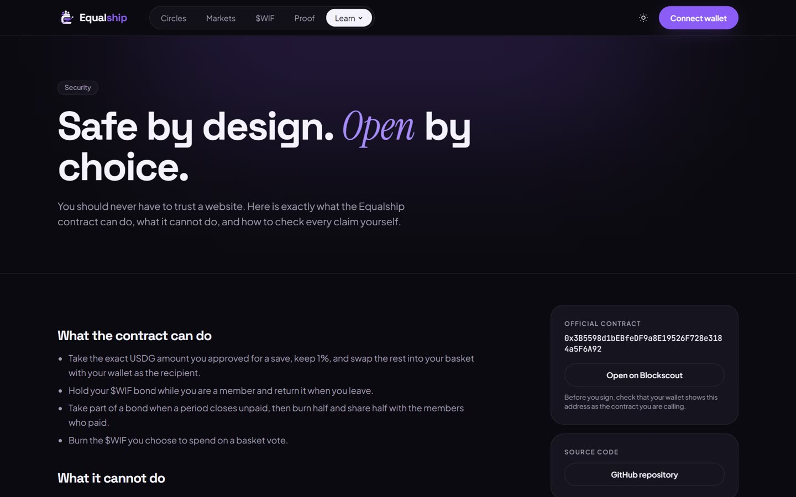](media/security.jpg)

## How it works

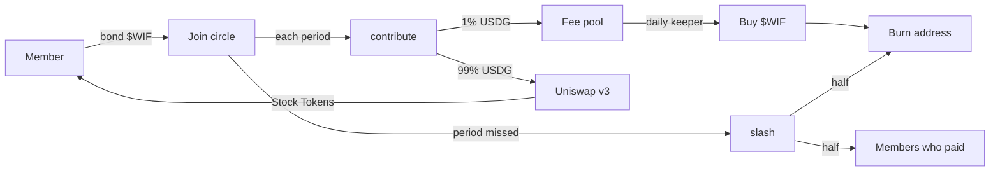

### 1. A circle

`createCircle(name, contribution, bond, period, maxMembers, slashBps, legs)` sets the amount in USDG, the period (one hour to 31 days), the $WIF bond, the slash rate and a basket of up to five legs. A leg is a token, a weight in basis points and a Uniswap v3 path from USDG to the token. The creator joins as the first member.

### 2. A save

`contribute(circleId, minOuts)` takes the contribution, keeps 1% in the fee pool, and swaps the rest leg by leg with the member as recipient. `minOuts` comes from a live QuoterV2 quote with a slippage limit, so a save fails instead of filling at a bad price.

### 3. A slash

When a period closes unpaid, anyone can call `slash(circleId, member)`. The penalty is the slash rate of the bond for each missed period. Half goes to the burn address. Half is shared with the other members through an accumulator, so slashing costs the same no matter how big the circle is.

### 4. A vote

`proposeBasket` opens a vote for two periods (at least one day). `vote` burns the $WIF a member puts behind yes or no. `executeBasket` applies the basket if more $WIF was burned for it than against it and at least half of the members voted yes.

### 5. The burn

`buyAndBurn(path, amountIn, minWifOut)` swaps the fee pool along USDG, WETH, $WIF and sends the output to the burn address. Only the keeper can call it, so nobody can force a burn with a zero minimum and sandwich it. A daily Vercel cron calls it.

## The $WIF flywheel

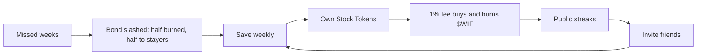

| Path | What happens to $WIF |
| :- | :- |
| Bond | Locked for as long as a member saves |
| Fee buyback | 1% of every save buys $WIF and burns it |
| Missed period | Half of the penalty is burned, half rewards the members who paid |
| Basket vote | Every vote is burned, 1 $WIF per vote |

## Proof of Commitment

Every save updates a public profile per wallet: periods paid, best streak, missed periods, total saved, circles joined, first and last payment. Any contract can ask:

```solidity
function isCommitted(address account, uint32 minPaid, uint32 minStreak, uint64 maxIdle) external view returns (bool);

// only count wallets that saved 4 periods in a row and paid within 8 days
require(IEqualship(EQUALSHIP).isCommitted(voter, 4, 4, 8 days), "not a committed saver");
```

World is Fair checks for farmed votes offchain after voting closes. With this check, a vote can require a committed saver at the moment it is cast, because a month of real weekly payments is expensive to fake.

## Architecture

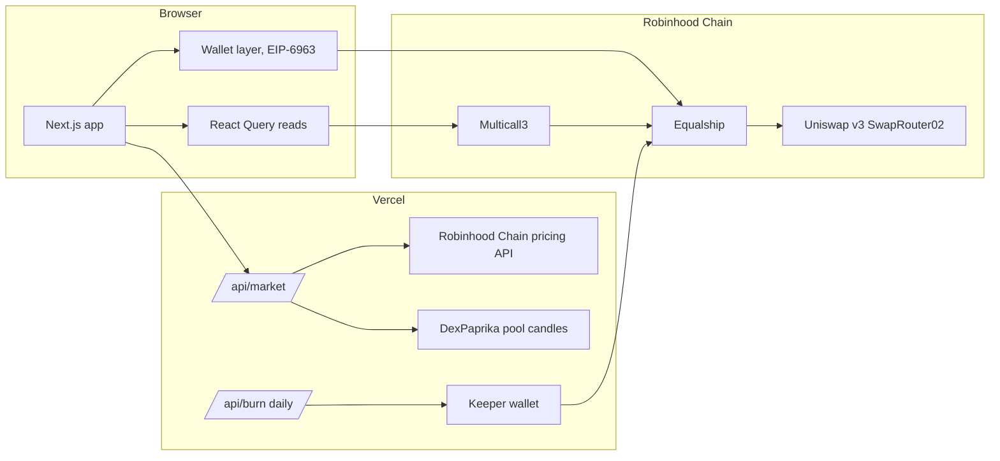

| Component | What it does |
| :- | :- |
| [`contracts/src/Equalship.sol`](contracts/src/Equalship.sol) | Circles, saves, slashing, rewards, basket votes, buyback and burn, Proof of Commitment |
| [`src/lib/wallet.tsx`](src/lib/wallet.tsx) | Wallet discovery (EIP-6963), connect, switch chain, disconnect, typed reads and writes on viem |
| [`src/lib/market.ts`](src/lib/market.ts) | Live quotes and 24 hour candles for every asset |
| [`src/app/api/burn/route.ts`](src/app/api/burn/route.ts) | The daily buyback and burn |
| [`video/`](video/README.md) | The demo film pipeline |

## Design and user experience

* **One look across the app.** Space Grotesk headlines with a serif accent, Plus Jakarta Sans for reading, JetBrains Mono for numbers, the brand purple, rounded panels and pill buttons.
* **Dark and light.** Dark by default, one click to light, saved per browser with no flash on load.
* **Every wallet.** Every installed wallet is detected and listed. The account menu copies the address, opens it on Blockscout, switches wallet or disconnects for real.
* **Live everywhere.** Prices, charts and contract numbers refresh on their own, with a live dot so you know.
* **Phones first.** Every page is checked at phone width with no sideways scrolling.
* **Honest by default.** Region notice before any Stock Token buy, exact approvals, and a plain words risk page.

## Verification and security

| Check | Result |
| :- | :- |
| Source verification | Exact match for creation and runtime bytecode on [Sourcify](https://repo.sourcify.dev/4663/0x3B5598d1bEBfeDF9a8E19526F728e3184a5F6A92) |
| Unit and fuzz tests | 17 passing (`forge test`) |
| Mainnet fork test | Buys real NVDA and SPY through live pools and burns real $WIF |
| Dry run | Deploy and first circle rehearsed on a copy of mainnet as the real deployer wallet |
| Web security | Strict Content Security Policy, no framing, HSTS, `security.txt` |

Security properties of the contract:

* Never holds a member's Stock Tokens.
* Approvals are for the exact amount of each action.
* The fee is capped at 2% in code. No proxy, no upgrade path.
* A bond can only go back to its member, to the burn address, or to the members of the same circle.
* Fees can only leave the contract as $WIF sent to the burn address.

The full review, including known limits, is in [SECURITY.md](SECURITY.md).

## Build log

| Date | Milestone |
| :- | :- |
| 7 Nov 2026 | Research of all entries, product chosen, contract written, 17 tests and the mainnet fork test passing |
| 8 Nov 2026 | First app, repository renamed, live on Vercel |
| 9 Nov 2026 | Deployed to mainnet, first circle and first save, source verified |
| 9 Nov 2026 | Full redesign, live markets, multi wallet, security headers, demo film |

## Quickstart for developers

Requirements: [Foundry](https://book.getfoundry.sh) and Node 20 or newer.

```bash
git clone https://github.com/angelraph/equalship.git
cd equalship
```

```bash
# contracts: unit and fuzz tests
cd contracts && forge test && cd ..
```

```bash
# app against mainnet
cp .env.example .env.local
npm install
npm run dev
```

Rehearse on a local copy of Robinhood Chain mainnet, with nothing broadcast:

```bash
anvil --fork-url https://rpc.mainnet.chain.robinhood.com --chain-id 4663 --port 8545 &
cd contracts
ROBINHOOD_RPC_URL=http://127.0.0.1:8545 forge test --match-contract Fork -vv
```

Deploy, create a circle and run the flywheel (forge asks for the key at a hidden prompt):

```bash
cd contracts
RPC=https://rpc.mainnet.chain.robinhood.com
forge script script/Deploy.s.sol --rpc-url $RPC --broadcast --interactive
forge script script/DemoCircle.s.sol --sig "run(address)" <EQUALSHIP> --rpc-url $RPC --broadcast --interactive
forge script script/DemoActions.s.sol --sig "run(address,uint256)" <EQUALSHIP> 0 --rpc-url $RPC --broadcast --interactive
```

## Repository layout

```
contracts/
  src/Equalship.sol          the contract
  test/                      unit, fuzz and mainnet fork tests
  script/                    Deploy, DemoCircle, DemoActions, addresses
  verification/              standard JSON input used for source verification
src/
  app/                       every page, /api/market and the /api/burn cron
  components/                UI, charts, wallet picker
  lib/                       chain config, ABI, wallet layer, market data, FAQ
media/                       screenshots and the film thumbnail
video/                       narration, screenshots and frame renderer for the demo film
public/.well-known/          security.txt
```

## Documentation

| Document | Contents |
| :- | :- |
| [SUBMISSION.md](SUBMISSION.md) | The hackathon submission |
| [SECURITY.md](SECURITY.md) | Security review, trust model and known limits |
| [video/README.md](video/README.md) | How the demo film is made |
| [equalship.vercel.app/how](https://equalship.vercel.app/how) | How it works, step by step |
| [equalship.vercel.app/faq](https://equalship.vercel.app/faq) | Frequently asked questions |
| [equalship.vercel.app/fees](https://equalship.vercel.app/fees) | Every cost and where it goes |
| [equalship.vercel.app/developers](https://equalship.vercel.app/developers) | Functions, events and the registry |
| [equalship.vercel.app/risk](https://equalship.vercel.app/risk) | Risk disclosure |

## Risks

Stock Tokens, Ether and $WIF can lose value. Stock Tokens are not available to US persons and are restricted in some countries. Missing periods costs part of your bond. The contract is tested and source verified but has not had a paid third party audit. Equalship is independent and is not affiliated with, endorsed by, or sponsored by Robinhood Markets, Inc. Nothing here is investment advice.

## License

[MIT](LICENSE) · Built for the World is Flat hackathon on Robinhood Chain
